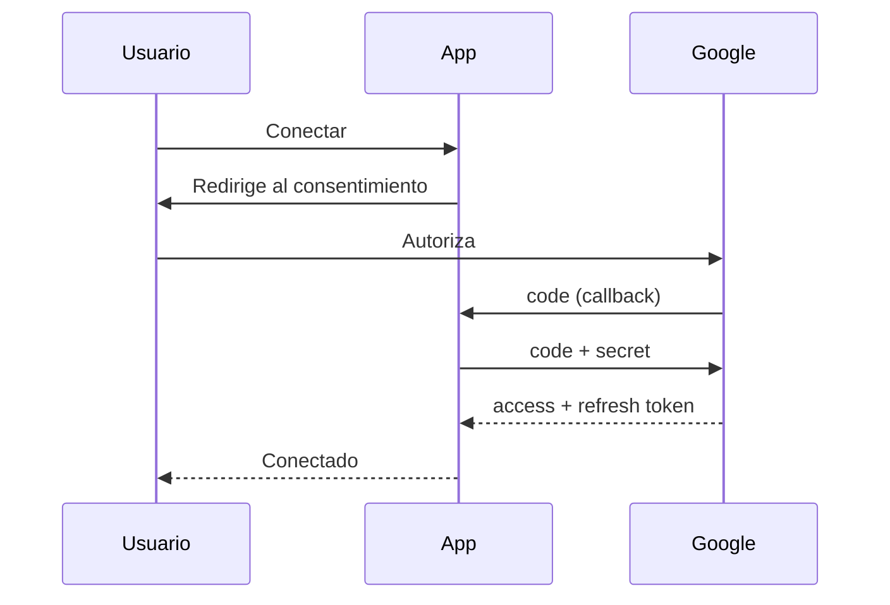

# Documentación a dos niveles, siempre con diagrama

Una doc que solo entiende quien ya sabía cómo funciona no documenta nada. Otra que solo
tranquiliza a negocio no sirve para mantener el código. Esta skill exige las dos cosas en
el mismo documento, y un dibujo que evite tener que reconstruir el flujo mentalmente.

## Las tres reglas

1. **Cada sección importante se explica en los dos registros.** Primero *qué problema
   resuelve y qué cambia para quien lo usa* (sin jerga), después *cómo está hecho*
   (nombres de fichero, funciones, endpoints, estructuras).
2. **Siempre hay al menos un diagrama.** Si no encuentras uno que aporte, es señal de que
   aún no entiendes el flujo lo bastante para documentarlo.
3. **Se documenta lo que hace, no lo que te gustaría que hiciera.** Las limitaciones y lo
   que deliberadamente NO hace son parte del documento, no una nota al pie.

## Estructura por defecto

Adáptala, no la sigas como un formulario. El orden importa: el "para qué" antes del "cómo".

```
# <Nombre> — <qué resuelve, en una línea>

> Una frase para quien solo va a leer esto. Enlaces al código.

## Qué problema resuelve        <- negocio. Sin una sola palabra técnica.
## La decisión de la que cuelga todo lo demás
## Cómo funciona                <- técnico + DIAGRAMA
## Qué NO hace (y por qué)      <- honestidad; evita el 80% de las dudas
## Detalles que solo se ven al usarlo   <- redondeos, límites, casos raros
```

## Los dos registros, en la práctica

| | Negocio | Técnico |
|---|---|---|
| Responde a | "¿qué gano y qué me arriesgo?" | "¿dónde toco si esto falla?" |
| Vocabulario | el del dominio (receta, pedido, factura) | el del código (función, endpoint, tabla) |
| Ejemplo | "pedir la receta para seis recalcula las cantidades sin crear otra receta" | "`scale_active_recipe()` reescribe `session_state.json`; la librería no se toca" |

Un truco que funciona: escribe la frase de negocio y, si al leerla en voz alta suena a
manual de instrucciones, todavía es técnica.

## Diagramas

Mermaid siempre (se renderiza en GitHub, GitLab y la mayoría de visores). Elige el tipo
por lo que quieras enseñar, no por costumbre:

| Quieres enseñar | Usa |
|---|---|
| Quién llama a quién y en qué orden, sobre todo si hay ida y vuelta | `sequenceDiagram` |
| Un camino con decisiones y bifurcaciones | `flowchart TD` |
| Qué cambia y qué no, dos mundos separados | `flowchart LR` con `subgraph` |
| Estados por los que pasa algo | `stateDiagram-v2` |
| Cómo se relacionan las entidades / el modelo de datos | `erDiagram` |

Sequence para una integración con OAuth, por ejemplo:



Reglas para que no se rompan ni estorben:

- **Etiquetas siempre entre comillas** (`A["texto"]`): los paréntesis y los dos puntos
  sin comillas rompen el render. Salto de línea con `\n`.
- **Un diagrama, una idea.** Si tiene más de ~12 nodos, son dos diagramas.
- **Etiqueta las flechas** cuando la condición importa (`-->|"si no hay match"|`).
- **Marca lo que NO ocurre** con línea discontinua (`-.->`) y su etiqueta: enseñar el
  camino que el sistema evita explica más que el que sigue.
- El diagrama no sustituye al texto; va **junto** al párrafo que explica.

## Tablas donde el texto se hace lista

Reglas de redondeo, formatos aceptados, casos límite, permisos por rol: si lo estás
escribiendo con "si… entonces…" tres veces seguidas, es una tabla. Con una columna de
ejemplo real, no inventado.

## Antes de darla por buena

- [ ] ¿Un compañero de negocio entiende para qué sirve leyendo solo las dos primeras
      secciones?
- [ ] ¿Quien la mantenga sabe qué fichero abrir? (enlaces al código, no solo nombres)
- [ ] ¿Hay al menos un diagrama y cuenta algo que el texto no cuenta mejor?
- [ ] ¿Está lo que NO hace?
- [ ] ¿Los ejemplos son datos reales del proyecto, no `foo` y `bar`?
- [ ] ¿Sobrevive a que alguien la lea dentro de seis meses sin contexto?

## Cómo se escribe en ESTE repo

- **Los documentos van en inglés**, aunque la app hable español. Es la regla del README:
  la app es para un hispanohablante, el código y la documentación son en inglés.
- **`docs/`** para lo que tiene entidad propia; el **README** solo para lo que necesita
  alguien que acaba de clonar. Si una sección del README pasa de ~15 líneas, es un doc.
- **Enlaza al código con rutas relativas** (`[`src/scaling.py`](../src/scaling.py)`), no
  solo el nombre del fichero.
- **Los ejemplos salen de `src/recipes/`**: gramos de patata, tiempos de horno, `sal — al
  gusto`. Nunca `foo`/`bar`.
- Menciona la restricción de fondo cuando aplique: **todo corre en local**. Si algo sale a
  la red (Drive, el backend `claude` de visión), dilo explícitamente, porque es la
  excepción.

Ejemplos de referencia ya escritos así:

| Documento | Qué imitar |
|---|---|
| [`docs/scaling.md`](../../../docs/scaling.md) | los dos registros, tres diagramas, la sección de "lo que NO hace", tablas con datos reales |
| [`docs/voice.md`](../../../docs/voice.md) | la cita inicial que orienta y enlaza, la tabla de componentes, "dónde vive en el código" |
| [`docs/spec.md`](../../../docs/spec.md) | el `flowchart TD` del pipeline de voz |

## Lo que no se hace

- Documentar deseos: si no está implementado, va en un apartado aparte marcado como tal.
- Repetir el código en prosa (`la función suma() suma dos números`).
- Diagrama de adorno que solo repite la lista de arriba.
- Muros de texto sin un solo encabezado: si son más de dos pantallas seguidas, falta
  estructura.
