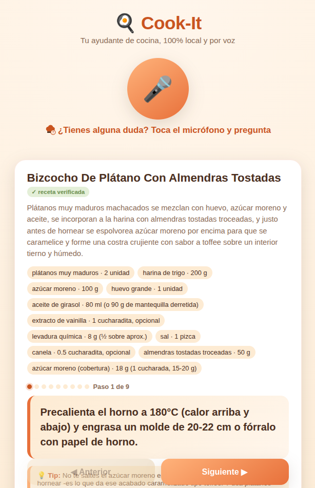

# Cook-It

Local voice assistant for cooking, guided step by step — 100% offline, no external API calls,
no token cost. Inspired by [BMO local AI agent](https://www.youtube.com/watch?v=l5ggH-YhuAw).

- [`docs/spec.md`](docs/spec.md) — project spec, architecture, roadmap.
- [`docs/feasibility.md`](docs/feasibility.md) — feasibility analysis and real latency benchmarks.
- [`docs/voice.md`](docs/voice.md) — details of the voice subsystem (STT/TTS).

This repo is the **proof of concept**: it lives in [`src/`](src/) — a web API (FastAPI) + a
voice interface in the browser, plus a couple of CLI scripts to try the pipeline without one.

<p align="center">
  
  
</p>

Note: the app itself speaks Spanish (recipes, prompts, spoken responses) — the assistant's
target user is a Spanish speaker, and its Piper voice/Whisper language are set to `es`. Only the
documentation and code (identifiers, comments) are in English; see `docs/spec.md` if you want to
adapt it to another language.

## Requirements

For this to work, the machine it runs on needs:

1. **[Ollama](https://ollama.com)**, running, with two models pulled: `gemma3`
   (`ollama pull gemma3`, generates new recipes) and `qwen2.5:3b`
   (`ollama pull qwen2.5:3b`, answers follow-up questions) — see
   `docs/feasibility.md` for why these two specifically, and how much RAM they need.
2. **[Piper](https://github.com/rhasspy/piper)** (TTS) — synthesizes the spoken responses. The app
   uses the `piper-tts` Python package and needs the `es_ES-davefx-medium` voice model downloaded.
3. **[faster-whisper](https://github.com/SYSTRAN/faster-whisper)** (STT) — transcribes what the
   user says. Runs Whisper's `small` model locally, no calls to the OpenAI API.

All three are 100% local — none of this calls a cloud service. See `docs/voice.md` for the
STT/TTS details and `docs/feasibility.md` for the real measured latency/RAM numbers.

## Environment variables

None are required if everything runs on the same machine with the default setup — they only
matter for adapting the app to a different machine/mic. See [`.env.example`](.env.example) for
the full list with defaults:

| Variable | What it's for | Default |
|---|---|---|
| `OLLAMA_BASE_URL` | Where Ollama is — only needed if it's not on `localhost` | `http://localhost:11434` |
| `OLLAMA_MODEL` | Model used to generate new recipes (picked for speed) | `gemma3` |
| `OLLAMA_QUESTION_MODEL` | Model used to answer follow-up questions (picked for quality) | `qwen2.5:3b` |
| `COOKIT_VOICE` | Which Piper voice to use (a name from [rhasspy/piper-voices](https://huggingface.co/rhasspy/piper-voices)) | `es_ES-davefx-medium` |
| `COOKIT_MIC_DEVICE` | ALSA mic device (CLI scripts only, not the web app) | `plughw:1,0` |
| `COOKIT_RECORD_SECONDS` | Seconds recorded per turn (CLI only) | `7` |

## Structure

```
src/
  api.py            Web API (FastAPI) -- backend for the browser voice interface,
                     serves the built frontend (see below) + /api/*
  recipe_engine.py  Shared logic: request a recipe (LLM+RAG), step navigation, router
  recipe_store.py   Recipe identity: every recipe's uuid and where it's stored
  common.py         Session state + voice synthesis/playback
  assistant_poc.py  Push-to-talk CLI (no browser)
  next_step.py      CLI "next step" button, no voice or LLM
  frontend/         Browser UI (React + TypeScript, Vite) -- Picker "/" (pick/create a
                     recipe) + Cook "/cook" (hands-free step-through) + Recipe
                     "/r/<uuid>" (a shared recipe), one SPA. `npm run build` writes to
                     src/static_dist/, which api.py serves; run_web.sh does this for
                     you. `npm run dev` for a fast dev loop instead (proxies /api/* to
                     api.py -- see frontend/vite.config.ts).
  recipes/          Local recipe database (JSON), source of truth for RAG
  recipes_shared/   Recipes the LLM/pantry flow generated, kept so their links stay
                     alive (created at runtime, not in git)
```

## Sharing a recipe

Every recipe has a UUID, and that UUID is its address:

```
https://<whatever host you reached Cook-It on>/r/af60ef76-9147-4c74-b46b-8c0b0b97e7ea
```

Opening it shows the whole recipe — ingredients, steps with their timers, the
tip — without starting to cook it; "empezar a cocinar" is one tap from there.
The 🔗 button on any recipe (on its own page, or on a card on the home screen)
hands the link to your phone's share sheet, or copies it to the clipboard on a
desktop.

Recipes the LLM generates get a UUID too, so a dish you asked for by voice can
be sent to someone exactly like a curated one. Two caveats, both of them the
consequence of Cook-It being local-only:

- **A link only works on the Cook-It that made it.** There is no central
  registry — the UUID means nothing to anyone else's install, which answers
  with "no conozco esta receta".
- **The host has to be reachable** by whoever you send it to. On a home
  network that means the same Wi-Fi.

Curated recipes keep their UUID in their own JSON file (`src/recipes/*.json`),
so their links survive restarts and are the same for everyone who clones the
repo; a hand-written recipe added without one gets it assigned the first time
it's loaded.
