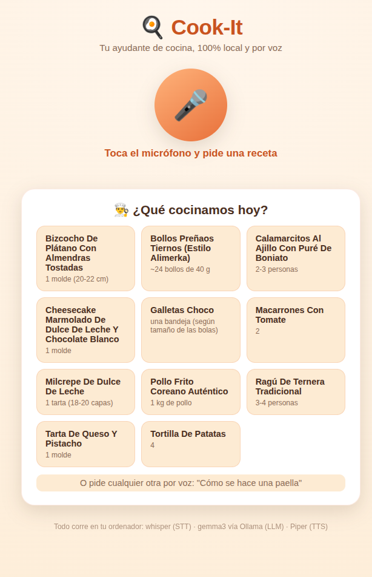

# Cook-It

Local voice assistant for cooking, guided step by step — 100% offline, no external API calls,
no token cost. Inspired by [BMO local AI agent](https://www.youtube.com/watch?v=l5ggH-YhuAw).

- [`docs/spec.md`](docs/spec.md) — project spec, architecture, roadmap.
- [`docs/feasibility.md`](docs/feasibility.md) — feasibility analysis and real latency benchmarks.
- [`docs/voice.md`](docs/voice.md) — details of the voice subsystem (STT/TTS).

This repo is the **proof of concept**: it lives in [`src/`](src/) — a web API (FastAPI) + a
voice interface in the browser, plus a couple of CLI scripts to try the pipeline without one.

<p align="center">
  
  
</p>

Note: the app itself speaks Spanish (recipes, prompts, spoken responses) — the assistant's
target user is a Spanish speaker, and its Piper voice/Whisper language are set to `es`. Only the
documentation and code (identifiers, comments) are in English; see `docs/spec.md` if you want to
adapt it to another language.

## Requirements

For this to work, the machine it runs on needs:

1. **[Ollama](https://ollama.com)**, running, with two models pulled: `gemma3`
   (`ollama pull gemma3`, generates new recipes) and `qwen2.5:3b`
   (`ollama pull qwen2.5:3b`, answers follow-up questions) — see
   `docs/feasibility.md` for why these two specifically, and how much RAM they need.
2. **[Piper](https://github.com/rhasspy/piper)** (TTS) — synthesizes the spoken responses. The app
   uses the `piper-tts` Python package and needs the `es_ES-davefx-medium` voice model downloaded.
3. **[faster-whisper](https://github.com/SYSTRAN/faster-whisper)** (STT) — transcribes what the
   user says. Runs Whisper's `small` model locally, no calls to the OpenAI API.

All three are 100% local — none of this calls a cloud service. See `docs/voice.md` for the
STT/TTS details and `docs/feasibility.md` for the real measured latency/RAM numbers.

## Settings

All of it lives in [`src/settings.yml`](src/settings.yml), which **is committed** — there are no
secrets in it (Cook-It talks to nothing but the machine it runs on), and which model answers
your questions or which voice speaks is part of how the project is put together. Nothing has to
be set up: every value already has a working default for a single-machine install.

| Setting | What it's for | Default |
|---|---|---|
| `ollama.base_url` | Where Ollama is — only needed if it's not on `localhost` | `http://localhost:11434` |
| `ollama.model` | Model used to generate new recipes (picked for speed) | `gemma3` |
| `ollama.question_model` | Model used to answer follow-up questions (picked for quality) | `qwen2.5:3b` |
| `voice.piper` | Which Piper voice to use (a name from [rhasspy/piper-voices](https://huggingface.co/rhasspy/piper-voices)) | `es_ES-davefx-medium` |
| `vision.backend` | Who reads the pantry photo: `ollama`, `moondream` or `claude` (the last one needs the network) | `ollama` |
| `vision.ollama_model` / `vision.moondream_model` / `vision.claude_model` | The model each backend uses | `gemma3` / `moondream` / `sonnet` |
| `vision.keep_alive` | How long Ollama keeps the vision model resident (cold start is ~180s on CPU) | `30m` |
| `drive.enabled` | Google Drive sync (see below) — the only setting that makes Cook-It use the network | `false` |
| `drive.folder` | The Drive folder it creates and syncs into | `Cook-It` |
| `cli.mic_device` | ALSA mic device (CLI scripts only, not the web app) | `plughw:1,0` |
| `cli.record_seconds` | Seconds recorded per turn (CLI only) | `7` |

To change something without editing the committed file, in order of precedence:

1. **An environment variable**, for a one-off run — `OLLAMA_MODEL=llama3 ./run_web.sh`. The
   variable for each setting is named in `settings.yml`'s comments and in `src/settings.py`.
2. **`src/settings.local.yml`** (gitignored, same shape, only the keys you want) for what
   genuinely differs on your machine — your mic device, an Ollama on another box:

   ```yaml
   cli:
     mic_device: plughw:2,0
   ```

## Recipes in Google Drive (optional)

Recipes are JSON because that's what the app reads, but JSON is a poor thing to hand a person.
With `drive.enabled: true`, Cook-It syncs them to a folder in your Drive **as Markdown** — you
open one on your phone, change `500 g` to `600 g`, and pull it back. The translation
([`src/recipe_markdown.py`](src/recipe_markdown.py)) is lossless in both directions, which is
the only reason syncing both ways is safe; there's a round-trip check over every recipe in the
repo behind that claim — run it yourself with `python3 src/recipe_markdown.py check`.

This is the one part of Cook-It that talks to the internet, and it's off until you turn it on.
Run [`src/setup_drive.sh`](src/setup_drive.sh): it does the project, the API and the checking,
and hands you the two links and the exact redirect URI for the one step that has no CLI.

Creating the OAuth **client** genuinely cannot be scripted — `gcloud alpha iap oauth-clients
create` was the only programmatic path, it went nonfunctional on 2026-01-19, and it only ever
produced clients locked to IAP, which can't have a redirect URI set. So, by hand:

1. Configure the consent screen once (External, with your own e-mail as the only test user —
   this app is only ever used by you).
2. *Create client → **Web application***, with the exact redirect URI the script prints
   (`https://<your-host>:3000/api/drive/callback` — character for character).
3. Save the downloaded JSON as `src/drive_client.json`; the script waits for it and tells you if
   it's the wrong client type or missing that URI.

Then `drive.enabled: true`, restart, and press **Conectar Google Drive** in the app.

The scope is `drive.file`: Cook-It can only see and touch **the files it created itself**. It
cannot read the rest of your Drive, and it cannot delete anything it didn't put there. The token
it gets back lands in `src/drive_token.json` — gitignored, and a real secret.

Syncing both ways, with one asymmetry worth knowing: **⬇ Traer de Drive never overwrites a
curated recipe** (the ones committed under `src/recipes/`). Those are source, so an edit to one
belongs in a commit, not in a background sync — the app reports them as skipped instead.

## Structure

```
src/
  api.py            Web API (FastAPI) -- backend for the browser voice interface,
                     serves the built frontend (see below) + /api/*
  recipe_engine.py  Shared logic: request a recipe (LLM+RAG), step navigation, router
  recipe_store.py   Recipe identity: every recipe's uuid and where it's stored
  common.py         Session state + voice synthesis/playback
  assistant_poc.py  Push-to-talk CLI (no browser)
  next_step.py      CLI "next step" button, no voice or LLM
  frontend/         Browser UI (React + TypeScript, Vite) -- Picker "/" (pick/create a
                     recipe) + Cook "/cook" (hands-free step-through) + Recipe
                     "/r/<uuid>" (a shared recipe), one SPA. `npm run build` writes to
                     src/static_dist/, which api.py serves; run_web.sh does this for
                     you. `npm run dev` for a fast dev loop instead (proxies /api/* to
                     api.py -- see frontend/vite.config.ts).
  recipes/          Local recipe database (JSON), source of truth for RAG
  recipe_markdown.py  Recipe JSON <-> Markdown, lossless both ways
  drive.py          Google Drive sync (optional, off by default)
  setup_drive.sh    Everything scriptable of the Google Cloud setup for it
  settings.yml      All configuration, committed (settings.py reads it)
  recipes_shared/   Recipes the LLM/pantry flow generated, kept so their links stay
                     alive (created at runtime, not in git)
```

## Sharing a recipe

Every recipe has a UUID, and that UUID is its address:

```
https://<whatever host you reached Cook-It on>/r/af60ef76-9147-4c74-b46b-8c0b0b97e7ea
```

Opening it shows the whole recipe — ingredients, steps with their timers, the
tip — without starting to cook it; "empezar a cocinar" is one tap from there.
The 🔗 button on any recipe (on its own page, or on a card on the home screen)
hands the link to your phone's share sheet, or copies it to the clipboard on a
desktop.

Recipes the LLM generates get a UUID too, so a dish you asked for by voice can
be sent to someone exactly like a curated one. Two caveats, both of them the
consequence of Cook-It being local-only:

- **A link only works on the Cook-It that made it.** There is no central
  registry — the UUID means nothing to anyone else's install, which answers
  with "no conozco esta receta".
- **The host has to be reachable** by whoever you send it to. On a home
  network that means the same Wi-Fi.

Curated recipes keep their UUID in their own JSON file (`src/recipes/*.json`),
so their links survive restarts and are the same for everyone who clones the
repo; a hand-written recipe added without one gets it assigned the first time
it's loaded.
