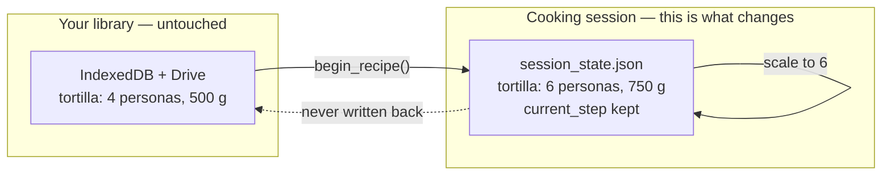
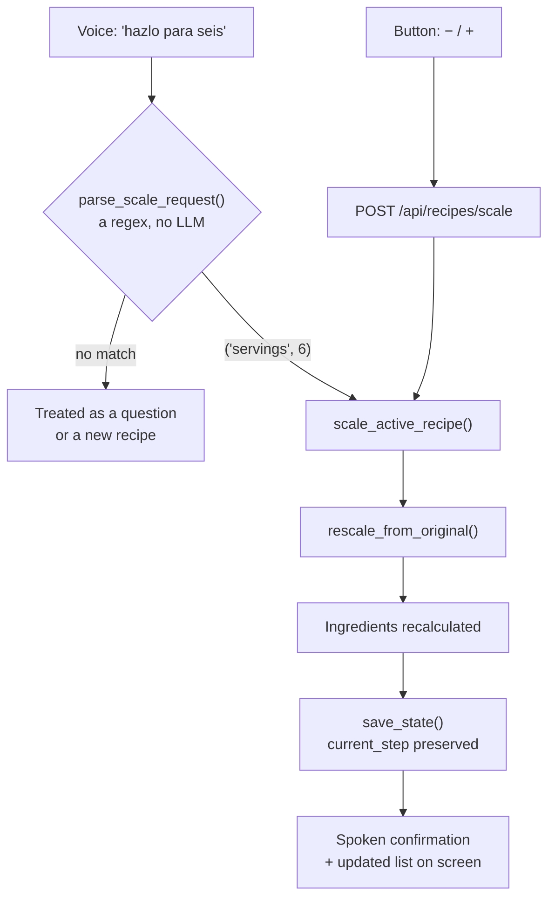
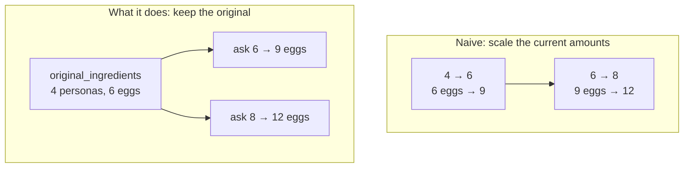

# Cooking for a different number of people

> How "hazlo para seis" is handled. Code: [`src/scaling.py`](../src/scaling.py),
> routed from [`recipe_engine.process_question()`](../src/recipe_engine.py) and
> exposed as `POST /api/recipes/scale`.

## The one decision everything follows from

A recipe asked for six people is **the same recipe**, cooked differently. So
scaling adjusts the **cooking session** — the working copy created by
`begin_recipe()` — and never the library.

Nothing is cloned, no UUID is minted, and the link you already sent someone
keeps showing the recipe as written. Start the recipe again and the original
amounts are back, because the session is thrown away and rebuilt from the
library.

## The path a request takes

Both entry points converge on the same function, so the voice flow and the
`− / +` buttons can never drift apart.

The router is deterministic on purpose. Someone standing over a hot pan
should not wait on a model to learn that "para seis" is a number, and a
regex can be tested exhaustively — which matters more here than usual,
because the expensive mistake is the **false positive**: silently rewriting
amounts for a user who asked something else.

| Said | Scales? | Why |
|---|---|---|
| "hazlo para seis personas" | yes | number + serving word |
| "para ocho" | yes | number, and the sentence is about the recipe |
| "el doble" / "la mitad" | yes | multiplier, needs no base |
| "cocina para 20 minutos" | **no** | the noun after the number is a time unit |
| "¿para qué sirve el laurel?" | **no** | "para" with no number |
| "¿puedo usar mantequilla?" | **no** | no number, no multiplier |

## Measuring from the original, not from the last answer

Asking for 6 and then for 8 must give exactly what asking for 8 would have.
Scaling the already-scaled compounds the rounding at every step.

The session carries `original_servings` and `original_ingredients` from the
first adjustment onwards, and every later request is computed from those.

## What is deliberately NOT scaled

**Ingredients with no number.** `{"amount": null, "unit": "al gusto"}` and
`"1 pizca"` pass through untouched. Twice the salt "to taste" is not a
quantity, it is a bug on screen.

**The wording of the steps.** A step that says *"añade los 600 g de
ternera"* keeps saying that. Rewriting prose is the LLM's job, it is slow,
and it fails in ways nobody notices until the dish is ruined. The ingredient
list is the one place amounts are authoritative, so it is the place that
changes — and the spoken confirmation says so out loud rather than letting
you assume the steps followed along.

## Rounding

Kitchen rounding, not float rounding.

| Amount | Rule | Example |
|---|---|---|
| Countable unit (`unidad`, `diente`, `hoja`, `molde`, …) | whole number, never below 1 | 6 eggs × 1.25 → **8**, not 7.5 |
| ≥ 100 | nearest whole | 833.3 g → 833 g |
| 10 – 99 | nearest half | 12.4 → 12.5 |
| 1 – 9 | one decimal | 2.55 → 2.6 |
| < 1 | two decimals | 0.333 → 0.33 |

Halves round **up** explicitly: Python's `round()` is banker's rounding, so
`round(6.5)` is `6`, which in a recipe reads as losing an egg.

## Reading the servings line

`servings` is free text as often as it is a number, so it is parsed rather
than assumed — and a range takes its **upper** bound, so nobody ends up with
half a dinner because the recipe hedged.

| Written | Base used | Asked for 2 → |
|---|---|---|
| `4` | 4 | `2` |
| `"3-4 personas"` | 4 | `"2 personas"` |
| `"1 molde (20-22 cm)"` | 1 | `"2 moldes (20-22 cm)"` |
| `"1 kg de pollo"` | 1 | `"2 kg de pollo"` — abbreviations are not pluralised |
| `"una bandeja"` | — | refuses, and says why |

A recipe with no number to scale from is not an error to swallow: the
assistant says it cannot recalculate rather than inventing a base of 1.
